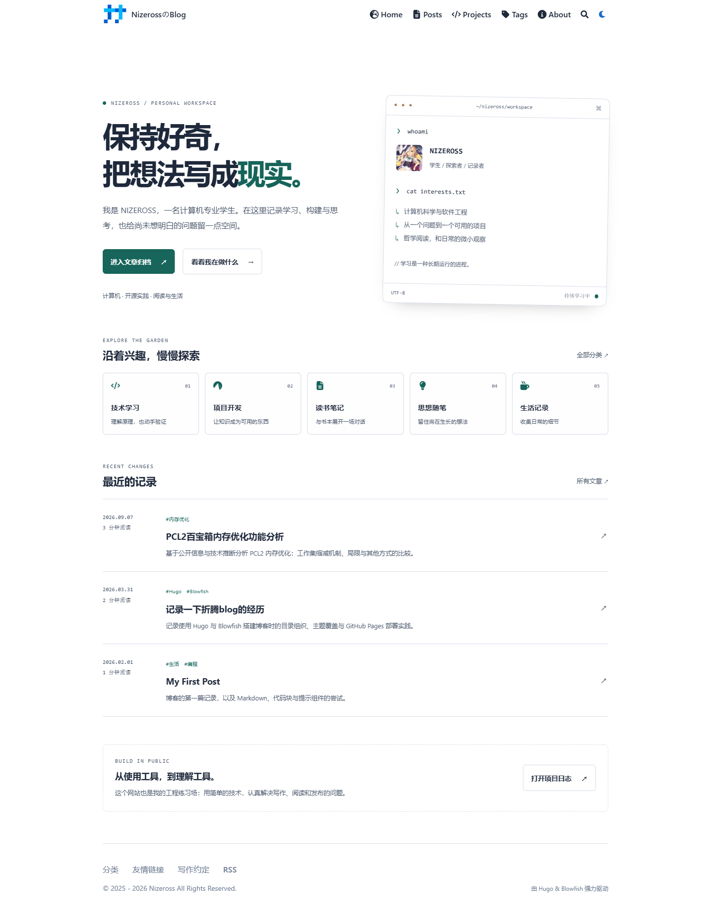
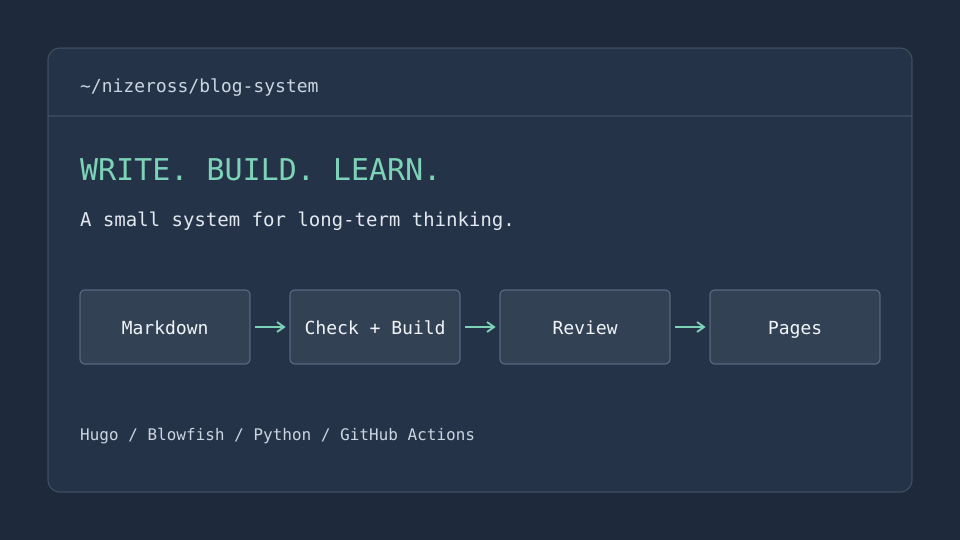

+++
title = "个人博客与自动化发布系统"
date = 2026-10-29T12:00:00+08:00
draft = false
description = "用 Hugo 与 Blowfish 搭建一个适合长期写作的数字花园，并实践内容检查、测试与审核发布。"
summary = "一个持续维护的工程练习：把写作、静态站点构建和自动化检查连接起来。"
stack = ["Hugo", "Blowfish", "Python", "GitHub Actions"]
github = "https://github.com/Nizeross/nizeross.github.io"
status = "持续维护"
weight = 1
tags = ["Hugo", "Blowfish", "工程实践"]
categories = ["项目开发"]
showHero = false
+++

## 为什么做这个项目

把日常技术笔记、读书记录与个人随笔放在自己能长期维护的地方，同时通过真实项目学习 Git、HTTP、测试和自动化发布。

## 项目一览

上图来自本地重构版本的真实浏览器测试。下面是这套系统的工作流示意：

## 技术栈与取舍

Hugo 将 Markdown 在构建时转成静态 HTML，Blowfish 提供搜索、目录、图片处理和明暗主题。少量原生 CSS 与 JavaScript 负责首页和阅读进度，避免把日常写作绑定到复杂应用框架。

## 开发过程

1. 审计现有文章路径、主题子模块、域名与部署流程。
2. 在独立本地分支开发界面与内容工具，保留已有文章 URL。
3. 加入 Frontmatter、Markdown、本地链接与浏览器检查。
4. 准备需要人工审核的发布流程，确认后才接入线上站点。

## 学到的知识

- 静态资源可以在构建时完成处理，无需运行数据库服务。
- CI 负责验证变更，CD 负责交付已经通过验证的产物。
- 草稿开关不等于审核；审核需要分支保护与部署权限共同约束。
- 设计系统应通过主题变量扩展，减少对上游模板的依赖。

## 后续改进

- 在审核后启用新的生产发布流程。
- 随文章积累改善分类与关联推荐。
- 定期复核工具链和主题内置脚本的安全更新。

源码与问题记录：[GitHub 仓库](https://github.com/Nizeross/nizeross.github.io)。
